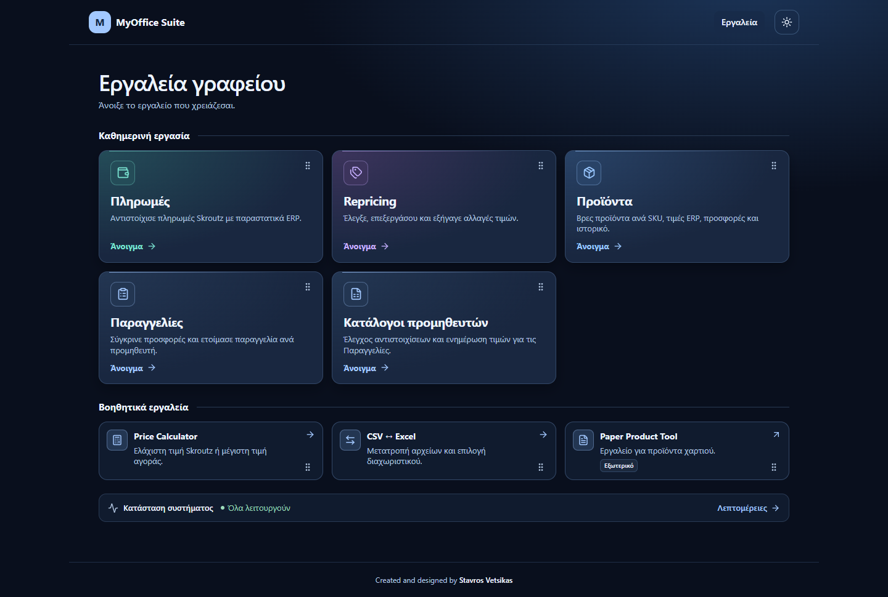
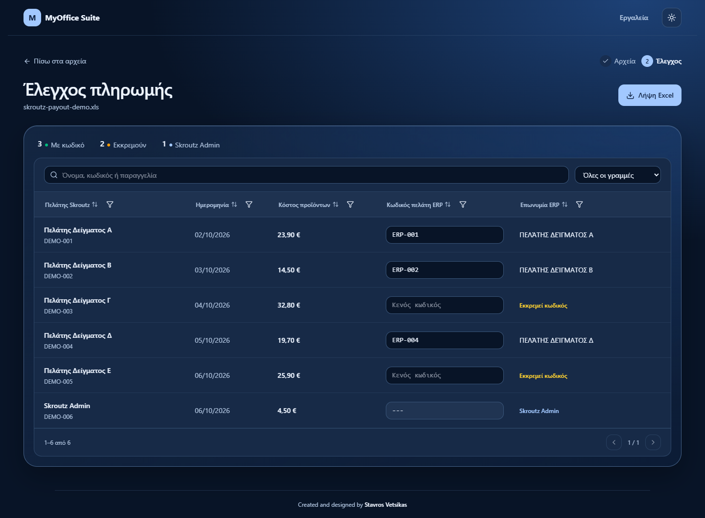
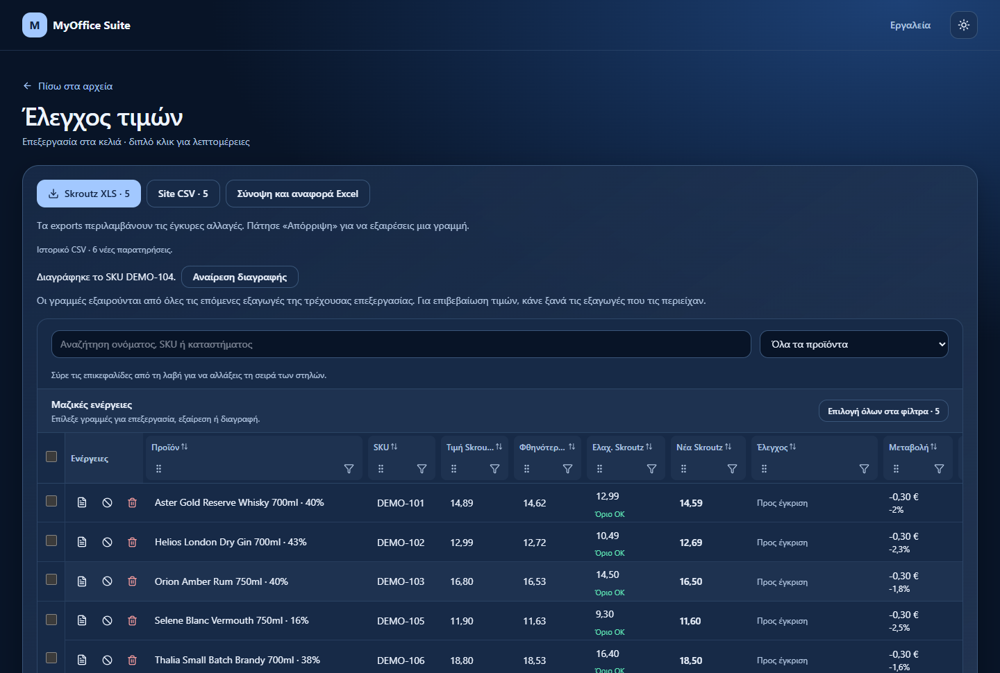
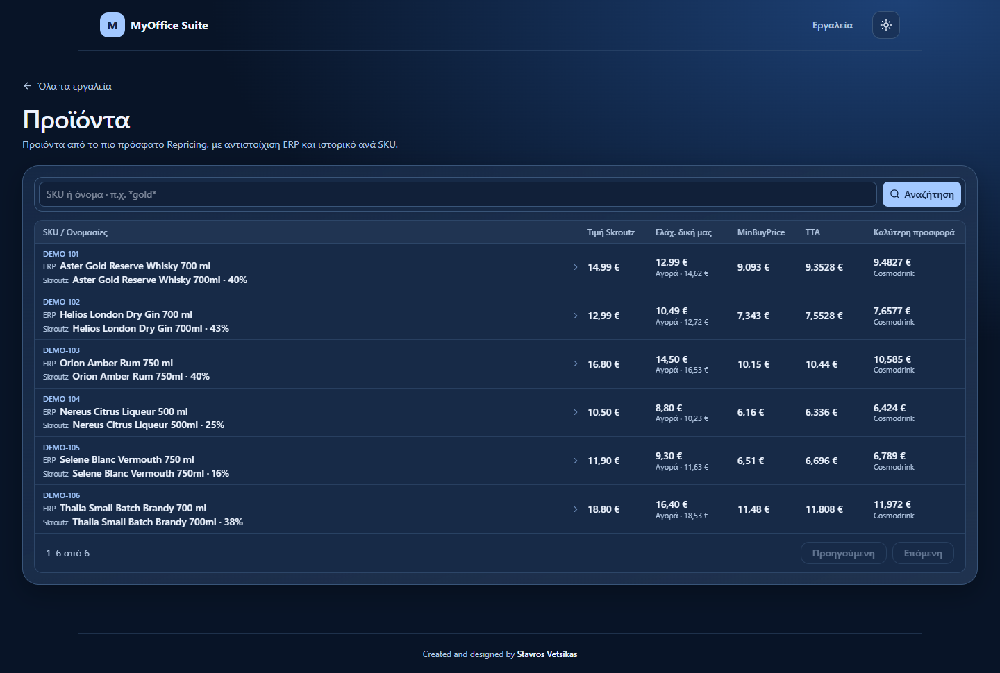
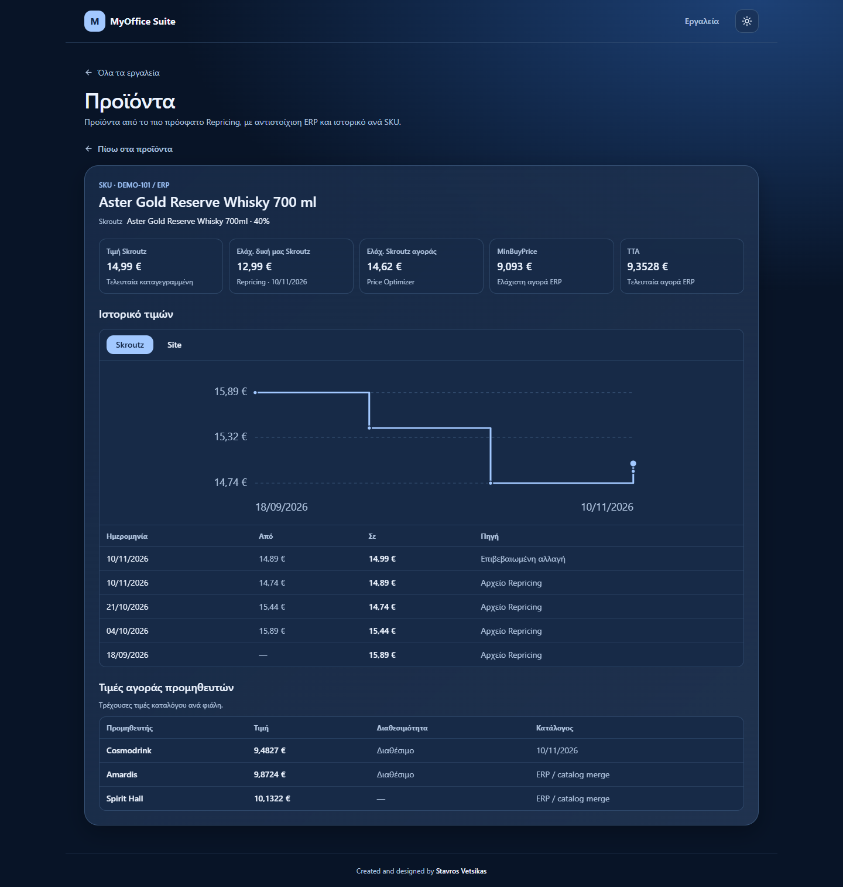
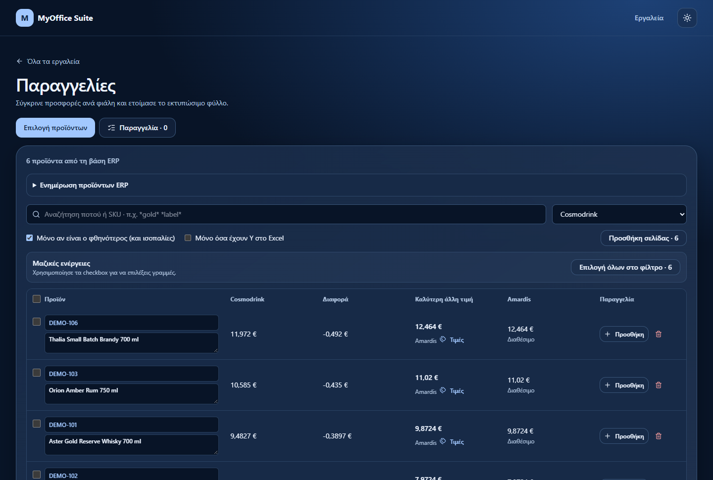
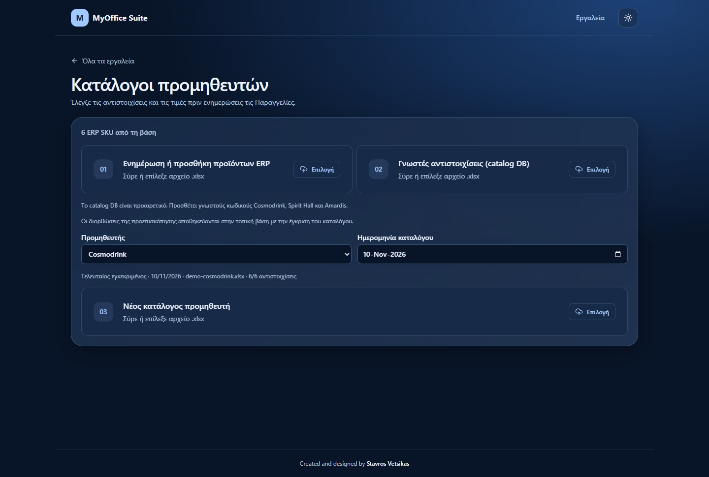
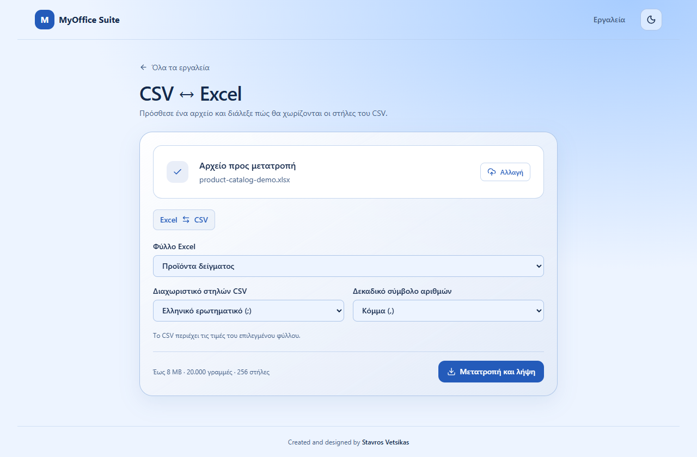

# MyOffice Suite

Χώρος εργασίας για πληρωμές, τιμές πώλησης, καταλόγους προμηθευτών και παραγγελίες.



## Εργαλεία

| Εργαλείο | Τι κάνει |
| --- | --- |
| **Πληρωμές** | Συγκεντρώνει πληρωμές Skroutz και παραστατικά ERP σε έναν πίνακα για έλεγχο, συμπλήρωση κωδικών πελατών και εξαγωγή σε Excel. |
| **Repricing** | Έλεγχος τιμών για Skroutz και site, με φίλτρα, μαζική επεξεργασία και εξαγωγές ανά κανάλι. Η σύνοψη και η αναλυτική αναφορά κατεβαίνουν μαζί σε Excel. |
| **Προϊόντα** | Η λίστα του πιο πρόσφατου Repricing, με ονομασίες ERP και Skroutz, αναζήτηση με `*`, τιμές ανά SKU και ιστορικό ανά κανάλι. |
| **Παραγγελίες** | Επιλογή από τον κατάλογο ERP, σύγκριση τιμών προμηθευτών και προετοιμασία παραγγελίας Excel με διαθέσιμα στοιχεία αποθέματος και πωλήσεων. |
| **Κατάλογοι προμηθευτών** | Προεπισκόπηση νέων τιμοκαταλόγων, έλεγχος αντιστοιχίσεων με SKU του ERP και ενημέρωση των τιμών μετά την έγκριση. |
| **Price Calculator** | Υπολογισμός ελάχιστης τιμής Skroutz ή μέγιστης τιμής αγοράς, με επιλογή ΦΠΑ. |
| **CSV ↔ Excel** | Μετατρέπει CSV σε Excel και φύλλα Excel σε CSV, με επιλογές φύλλου, διαχωριστικού και δεκαδικού συμβόλου. |
| **Paper Product Tool** | Συντόμευση προς το εξωτερικό εργαλείο για προϊόντα χαρτιού. |
| **Κατάσταση συστήματος** | Δείχνει τη διαθεσιμότητα του API και της βάσης δεδομένων. |

Το περιβάλλον υποστηρίζει φωτεινό και σκοτεινό θέμα, αναδιάταξη καρτών και πίνακες εργασίας με αναζήτηση και φίλτρα. Τα εργαλεία εμφανίζουν την πρόοδο στις εισαγωγές, στις εξαγωγές και στους ελέγχους. Όταν μια ενέργεια αποτύχει, μπορείς να δοκιμάσεις ξανά ή να διορθώσεις το αρχείο διατηρώντας την εργασία σου.

### Κατάλογοι και εξαγωγές

- Η καρτέλα **Προϊόντα** ακολουθεί το πιο πρόσφατο CSV του Repricing και εμφανίζει τα στοιχεία ERP όπου ταιριάζει το SKU. Το ιστορικό προηγούμενων εισαγωγών παραμένει διαθέσιμο.
- Οι **Παραγγελίες** και οι **Κατάλογοι προμηθευτών** χρησιμοποιούν την πλήρη λίστα από το `catalog merge` και τις συμπληρωματικές ενημερώσεις ERP.
- Η διαγραφή γραμμής στο **Repricing** ισχύει για την τρέχουσα επεξεργασία. Η γραμμή εξαιρείται από τις επόμενες εξαγωγές, τη σύνοψη και την αναλυτική αναφορά. Το αποθηκευμένο προϊόν και το ιστορικό του παραμένουν διαθέσιμα. Αν μια προηγούμενη εξαγωγή περιείχε τη γραμμή, κατέβασε νέο αρχείο πριν καταχωρίσεις τις δημοσιευμένες τιμές.

## Στιγμιότυπα εφαρμογής

Τα στιγμιότυπα χρησιμοποιούν δοκιμαστικά δεδομένα.

### Πληρωμές



### Repricing



### Προϊόντα και ιστορικό





### Παραγγελίες και κατάλογοι προμηθευτών





### CSV ↔ Excel



## Τεχνολογίες

React, TypeScript, Vite, Tailwind CSS, Python, FastAPI και SQLite.

## Τοπική εκτέλεση στα Windows

Χρειάζεσαι Python 3.15 και Node.js 24 ή νεότερη συμβατή έκδοση. Κάνε διπλό κλικ στο [Run-MyOffice.bat](Run-MyOffice.bat) για να ξεκινήσουν backend και frontend σε δύο παράθυρα. Στην πρώτη εκτέλεση εγκαθίστανται οι απαραίτητες εξαρτήσεις. Όταν είναι έτοιμα, άνοιξε το [MyOffice Suite](http://127.0.0.1:5173).

Η τοπική SQLite (`backend/data/myoffice.db`) αποθηκεύει τους καταλόγους, τις αντιστοιχίσεις προμηθευτών και το ιστορικό τιμών. Στην εκκίνηση η εφαρμογή ενημερώνει αυτόματα τη δομή της υπάρχουσας βάσης.

### Χειροκίνητη εκκίνηση

Από τη ρίζα του repository, ξεκίνησε το backend.

```powershell
python -m venv .venv
.\.venv\Scripts\python.exe -m pip install -r backend/requirements.txt
.\.venv\Scripts\python.exe -m uvicorn backend.main:app --host 127.0.0.1 --port 5072
```

Αν το περιβάλλον Python βρίσκεται ήδη μέσα στον φάκελο `backend`, χρησιμοποίησε το `backend\.venv\Scripts\python.exe`.

Σε δεύτερο τερματικό, ξεκίνησε το frontend.

```powershell
cd frontend
npm.cmd ci
npm.cmd run dev
```

Άνοιξε το [MyOffice Suite](http://127.0.0.1:5173).

### Docker

```powershell
docker build -t myoffice-suite .
docker run --rm -p 127.0.0.1:8080:8080 myoffice-suite
```

Άνοιξε το [MyOffice Suite μέσω Docker](http://127.0.0.1:8080). Το Docker image ξεκινά με το ιστορικό προϊόντων απενεργοποιημένο για χρήση ως demo.

Για προσωπική χρήση μέσω Docker, ενεργοποίησε το ιστορικό και σύνδεσε μόνιμο volume στη βάση.

```powershell
docker run --rm -p 127.0.0.1:8080:8080 -e MYOFFICE_PRODUCT_HISTORY=1 --mount type=volume,source=myoffice-data,target=/app/backend/data myoffice-suite
```

---

Created and designed by **Stavros Vetsikas**.
